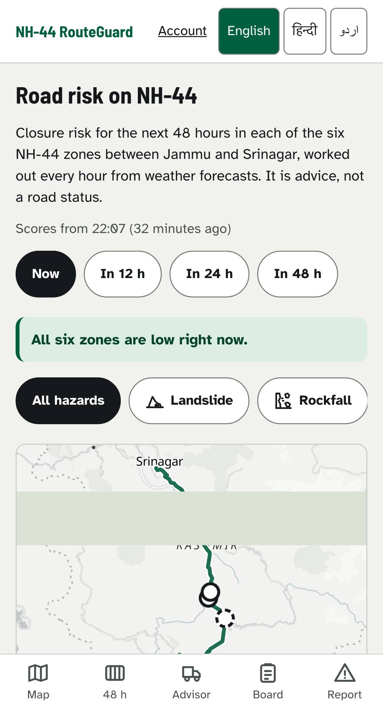
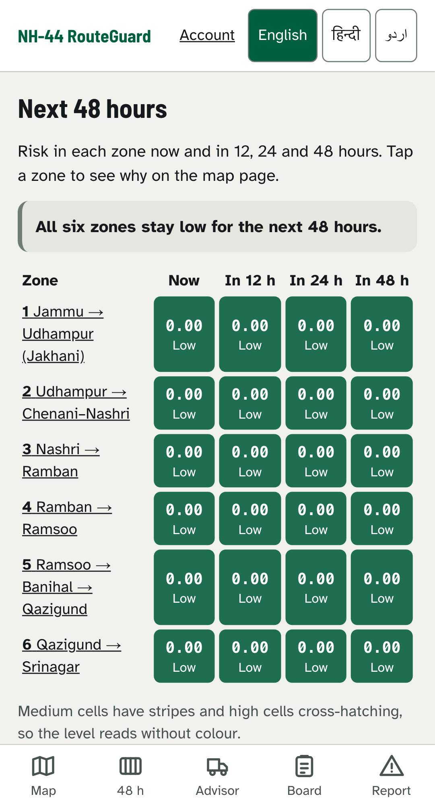
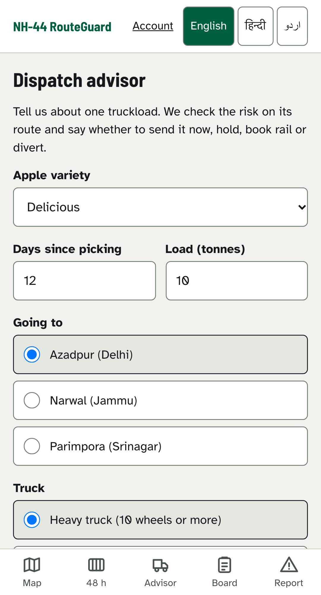
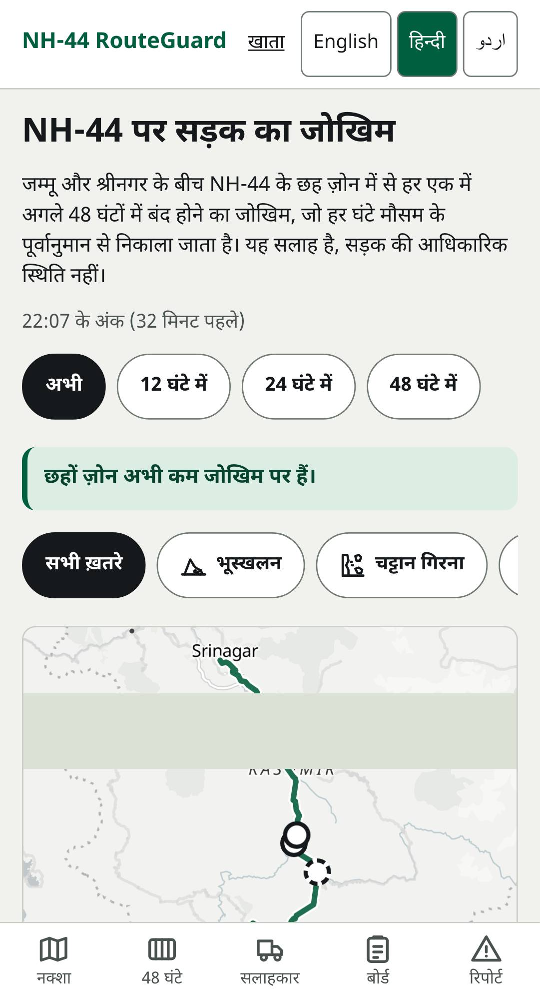
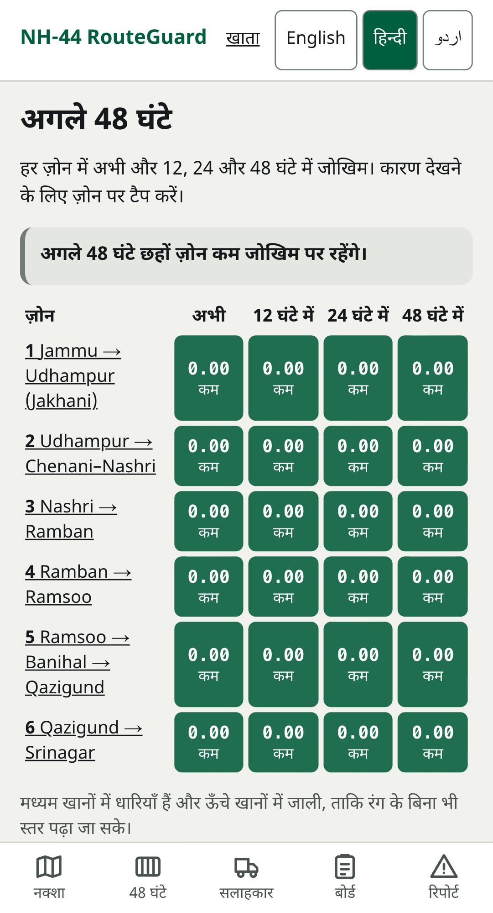
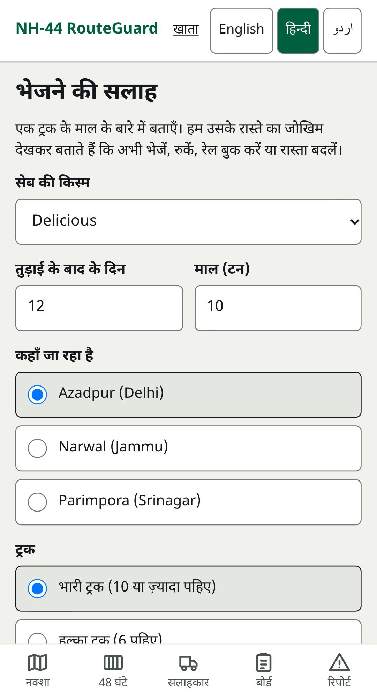
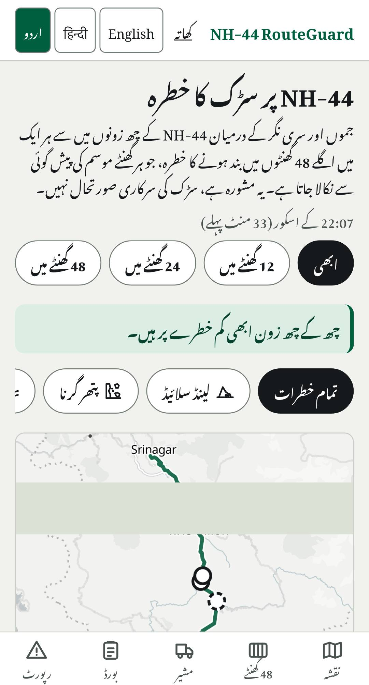
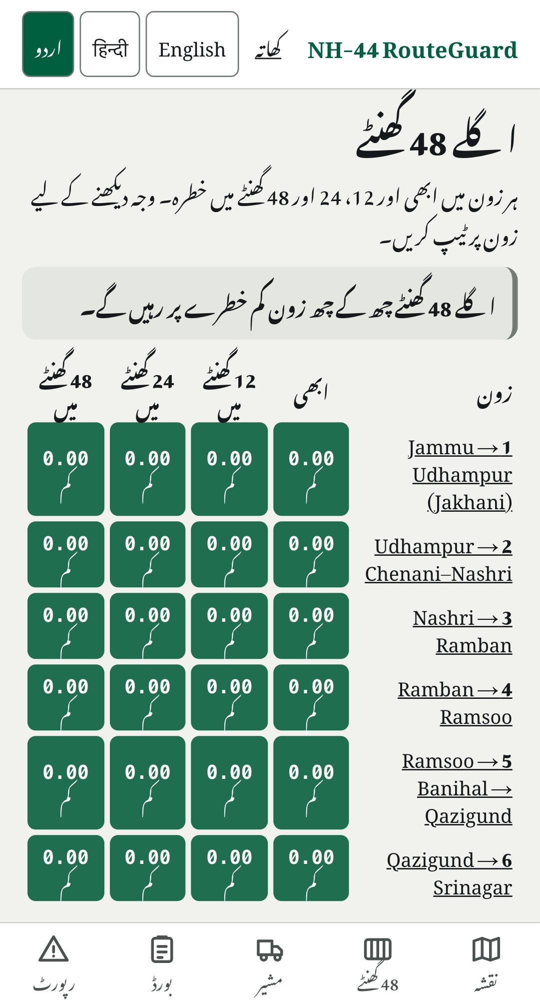
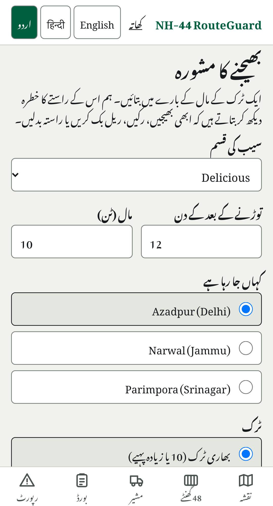
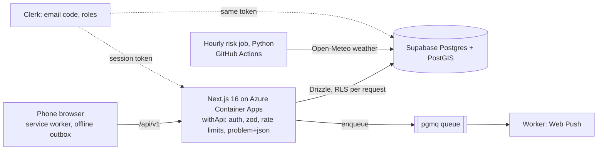

# NH-44 RouteGuard

Apple trucks from Kashmir have one all-weather road out, NH-44, and landslides, rockfall, flash floods and snow close it every season. RouteGuard gives growers, transport agents and drivers a 48-hour closure-risk forecast for six stretches of the highway and a dispatch advice for each lot: send, hold, rail or divert. Drivers and police can report hazards from the road.

RouteGuard is a student project. It is not an official government or police service. Follow instructions from J&K Traffic Police. In an emergency call 112.

Project Ananta Hackathon · Team 01

## Live link and "Try it"

**Live:** not deployed yet. We host on Azure Container Apps (section 4.1 of [the plan](docs/round3/BUILD_PROMPT.md)); the link goes here after the first deploy. Until then, run it locally (see [Setup](#setup-from-a-fresh-clone)).

Demo accounts (made by `node scripts/seed-demo.mts`). They are Clerk test emails: sign in with the email, then the code **424242**. No email is sent.

| Role | Email | Try this |
| --- | --- | --- |
| Admin | `routeguard.admin+clerk_test@example.com` | `/admin`: roles, official updates, reports, road status, audit log, failed jobs |
| Police (demo) | `routeguard.police+clerk_test@example.com` | Post an official update with its source; confirm a report |
| Agent | `routeguard.agent+clerk_test@example.com` | `/board`: six demo trucks in different states, live updates |
| Driver, vouched | `routeguard.driver1+clerk_test@example.com` | `/report/new`: the report goes live at once (solid marker) |
| Driver, not vouched | `routeguard.driver2+clerk_test@example.com` | `/report/new`: the report starts "unconfirmed" (dashed); try it offline |
| Grower | `routeguard.grower+clerk_test@example.com` | `/advisor`: advice for a lot; save it |

No sign-in is needed for the map, the 48 h strip and the advisor.

## Screenshots

Pixel 5 size, taken with `node scripts/ui/screenshots.mjs` on 25 Nov 2026 with the demo data.

| | Map | 48 h strip | Advisor |
| --- | --- | --- | --- |
| English |  |  |  |
| हिन्दी |  |  |  |
| اردو |  |  |  |

## How it works



**One request, traced:** `POST /api/v1/advice` → `proxy.ts` (language cookie, no auth needed) → `withApi()` in `src/server/http/with-api.ts` gives a request id, checks the Origin, rate-limits by IP (60 a minute, counted in Postgres), parses the body with a strict zod schema (`src/server/advice/advice.schemas.ts`) → the handler reads the newest risk rows and the Mughal Road / rail status → `decide()` in `src/shared/decide.ts` → JSON with a `reason_code` the phone translates. Offline, the phone runs the same `decide()` from its saved copy of the scores; a test checks both give the same answer.

**Code layout:** `app/api/v1/**/route.ts` are thin routes; each area in `src/server/<area>/` has `*.schemas.ts` (zod), `*.repository.ts` (Drizzle queries), `*.service.ts` where there is logic, and tests next to them. Shared logic the phone also runs lives in `src/shared/`. Screens are in `src/ui/`, pages in `app/[locale]/`.

## API

- Swagger UI: `/api/docs`. OpenAPI 3.1: `/api/v1/openapi.json`, generated from the routes' zod schemas; a test fails if a route is missing from it.
- Postman: [`postman/RouteGuard.postman_collection.json`](postman/RouteGuard.postman_collection.json), 42 requests with tests, including every error case. CI runs the keyless folders with newman.
- Errors are `application/problem+json` with a request id. Unknown `/api/*` paths answer 404 and wrong methods 405 with `Allow`.

| Endpoint | Who |
| --- | --- |
| `GET /api/v1/health`, `/health/ready` | public |
| `GET /api/v1/zones`, `/risk`, `/risk/summary`, `/road-status`, `/official-updates`, `/reports`, `/incidents`, `/model` | public |
| `POST /api/v1/advice` | public, 60 a minute per IP |
| `GET/PATCH/DELETE /api/v1/me`, `POST /me/onboarding`, `GET /me/realtime-token` | signed in |
| `POST /api/v1/reports`, `/reports/{id}/confirm`, `/reports/{id}/flag`, `GET /reports/{id}/photo` | signed in (rules per role) |
| `GET/POST /api/v1/shipments`, `PATCH /shipments/{id}` | agent, driver, grower (own rows) |
| `GET /api/v1/agents/drivers`, `POST /agents/invites`, `/invites/accept`, `/drivers/{id}/vouch` | agent, driver |
| `POST/DELETE /api/v1/push/subscriptions` | signed in |
| `/api/v1/admin/*` (users and roles, official updates, reports, road status, audit log, dead letters) | admin (police: official updates and reports) |
| `POST /api/v1/internal/jobs/run` | queue worker only (`JOBS_SECRET`) |

## Security and guardrails

- Login with Clerk email codes; roles in Clerk metadata, set only by an admin with a reason. `proxy.ts` guards pages, `withApi()` guards routes, and Row Level Security checks every row again in the database.
- CSP and security headers on every response, strict zod input checks, rate limits, an audit log nobody can edit, EXIF stripped from photos, locations rounded to about 1 km.
- CI: gitleaks, `npm audit`, a secret grep over the browser bundle and the Docker image, and checks for raw SQL and `dangerouslySetInnerHTML`.
- Details: [docs/security.md](docs/security.md) (threat table with tests) and [docs/guardrails.md](docs/guardrails.md) (police and safety rules, with why).

## Verification levels

`email` (Clerk code) → `agent_vouched` (your agent vouches for you) → `official` (police/admin, granted by an admin). Reports from vouched drivers and police go live at once; others need two confirmations from verified users within 2 km and 3 h. Details: [docs/verification.md](docs/verification.md).

## Languages

English, Hindi and Urdu on every screen and every API error, chosen with a cookie (no language in the URL). Urdu is right-to-left. CI fails if the three message files don't have the same keys. Reviews of safety text are tracked in [messages/REVIEW.md](messages/REVIEW.md); as of 25 Nov 2026 the safety strings are machine-drafted and **not yet reviewed** by fluent readers.

## Offline

A hand-written service worker keeps the app shell, the last risk scores and the advisor working with no signal. Reports written offline wait in an outbox (IndexedDB) and are sent with an idempotency key when the signal returns, so they never post twice. Signed-in responses are never cached, and private data is wiped on sign-out. Details: [docs/offline.md](docs/offline.md).

## Data and sources

### The 6 zones

| # | Stretch | Length (km) | Danger (km) | Risk |
| --- | --- | --- | --- | --- |
| 1 | Jammu → Udhampur (Jakhani) | 65 | 0.5 | low |
| 2 | Udhampur → Chenani–Nashri | 42 | 3.5 | medium |
| 3 | Nashri → Ramban | 28 | 6.5 | high |
| 4 | Ramban → Ramsoo | 22 | 9.5 | extreme |
| 5 | Ramsoo → Banihal → Qazigund | 32 | 6.0 | high |
| 6 | Qazigund → Srinagar | 62 | 0.0 | low |

### Incidents

- `data/incidents.csv` has 27 past closures from 2018 to 2026, each from a news or government source with a quote of 25 words or fewer. Added by Madhusudan, checked by Aryaveer. **It is not a complete list** of closures on NH-44.
- Rows we couldn't support (no date, no place, or a weak source) are in `data/incidents_unverified.csv` and are never loaded.
- `hazard_type` is one of `landslide`, `rockfall`, `flash_flood`, `snow_ice`, `accident`, `other`; `zone_id` is 1 to 6 and must match the km along `data/nh44_line.json`.
- Check: `python3 scripts/validate_incidents.py` (also in CI). Re-check the quotes against the sources: `python3 scripts/check_incident_sources.py`.
- A row is used only after someone other than `added_by` checks it: `python3 scripts/incidents_checklist.py` writes a checklist, then `--apply <file> --by "Name"` fills `verified_by`.
- Load into Supabase: `npm run db:seed-incidents -- --dry-run`, then without `--dry-run`. Only verified rows are loaded; rerunning updates rows instead of adding copies.

## Risk model and backtest

### How the score works

- Every hour we pull rain, snow, snow depth and temperature for 15 points along NH-44 from Open-Meteo.
- For each zone and hazard (landslide, rockfall, flash flood, snow/ice): **score = exposure × trigger**, both 0–1. Exposure is how prone the stretch is; trigger is how strong the weather is.
- A zone takes its worst point. `overall` is the highest of the 4 hazards, with a range that widens for 12/24/48 h ahead.
- Level: **low** below 0.30, **medium** 0.30–0.65, **high** above 0.65. Confidence goes up when a report or past incidents agree.
- All thresholds are our own starting values in [`lib/risk/config.json`](lib/risk/config.json), to be tuned in the backtest. Full details: [docs/risk-model.md](docs/risk-model.md).

**Backtest** ([docs/backtest.md](docs/backtest.md), `jobs/backtest.py`, run on 25 Nov 2026): of 16 verified incidents recent enough for archived forecasts, the 24 h forecast flagged the zone (medium or high) for 15 and the right hazard for 14; the 48 h forecast flagged the zone for 13. The cost is false alarms: 495 alarm days in 5994 zone-days at 24 h (about 2.5 per zone per 30 days). The sample is small; read the caveats in the doc.

### Hourly job

[`jobs/run_risk.py`](jobs/run_risk.py) fetches the weather (one Open-Meteo call), saves it to `weather_readings`, scores the 6 zones for 0/12/24/48 h and writes 24 rows to `risk_scores`. GitHub Actions runs it at minute 7 of every hour ([`.github/workflows/risk-job.yml`](.github/workflows/risk-job.yml)), then checks the new rows arrived.

Run it on your laptop without any key:

```bash
python3 -m venv jobs/.venv
jobs/.venv/bin/pip install -r jobs/requirements.txt
jobs/.venv/bin/python jobs/run_risk.py --dry-run
```

`--dry-run` fetches and scores, prints a table, and writes nothing. Run the tests with `jobs/.venv/bin/python -m pytest jobs/tests`.

- **Logs:** GitHub → **Actions** → **Risk job** → pick a run. A failed run is red and GitHub emails the repo owner.
- **Latest scores:** the `/status` page (locally: http://localhost:3000/status)
- **Run it now:** Actions → Risk job → **Run workflow**, or `gh workflow run risk-job.yml`.
- **Weather points:** [`jobs/points.json`](jobs/points.json), found with OpenStreetMap by [`jobs/tools/locate_points.py`](jobs/tools/locate_points.py).

## Testing

| What | How to run | Count (25 Nov 2026) |
| --- | --- | --- |
| Unit and API tests (Vitest): `decide()`, priority, schemas, problem+json, rate limits, every route's status codes with fake repositories | `npm test` (coverage: `npm test -- --coverage`) | 554 tests in 56 files, all passing; 41.7% of lines covered (most UI files have no unit tests) |
| Risk job (pytest) | `python3 -m pytest jobs/tests` | 151 passing |
| RLS tests against a local Supabase | `npm run db:test` (needs Docker) | see `supabase/tests/rls.test.sql` |
| Playwright on Pixel 5 and a 360 px phone | `npm run build && npm run e2e` (`E2E_DB=1` for the tests that need keys) | 12 tests per phone, plus 4 signed-in flows (report, offline outbox, board, official update) with the demo accounts; 9 per phone run in CI without keys |
| Postman / newman | `npx newman run postman/RouteGuard.postman_collection.json -e postman/ci.postman_environment.json` | 42 requests |
| Smoke test after each deploy | `node scripts/smoke.mjs <url>` | health, ready, risk + 304, home, 401, 404, 405, headers |

CI runs all of these except the RLS tests and the keyed Playwright and Postman folders, on every pull request.

## Performance and scaling

Measured on 25 Nov 2026, `next start` on an Apple M4 laptop reading the real database, `node scripts/load/risk.mjs`, 10 connections:

| `GET /api/v1/risk` | p50 | p99 | req/s |
| --- | --- | --- | --- |
| Cold first request | 1069 ms | | |
| Warm (memory cache) | 3 ms | 6 ms | 2980 |
| With ETag (304) | 2 ms | 4 ms | 3449 |

Lighthouse 12.8 mobile (simulated slow 4G and 4× slower CPU), `next start` on the same laptop, 25 Nov 2026:

| Page | Performance | Accessibility | Best practices | SEO | LCP | TBT | CLS |
| --- | --- | --- | --- | --- | --- | --- | --- |
| `/` (map) | 79 | 100 | 100 | 100 | 4.1 s | 130 ms | 0 |
| `/advisor` | 82 | 100 | 100 | 100 | 4.3 s | 30 ms | 0 |
| `/strip` | 84 | 100 | 100 | 100 | 4.0 s | 30 ms | 0 |

The map page first scored 27 (TBT 2,050 ms, CLS 0.6): the footer jumped when the scores arrived, and the 1 MB map library started at once. We now reserve the screen height and start the map when the browser is idle. Lighthouse 12 no longer has a PWA category, so there is no PWA score.

Risk is computed once an hour for everyone; reads are cached (ETag, `Cache-Control`, 60 s memory cache); writes go through a Postgres queue; the app is stateless and scales 0 to 3 replicas. The Azure replica test is not measured yet. Details: [docs/scaling.md](docs/scaling.md).

## Changes since Round 1

| Round 1 said | Now | Why |
| --- | --- | --- |
| Hosting on Vercel | Azure Container Apps (Azure for Students) | Google Cloud billing setup failed; Azure for Students needs no card and its credit covers the round |
| Supabase Auth, phone OTP | Clerk, one-time code by email | SMS is a paid Clerk feature on our free plan |
| Serwist service worker | Hand-written service worker | Full control over what is never cached (signed-in data) |
| Verified drivers | Same, plus a written verification model, report confirmations and an audit log | Makes reports trustworthy; an addition, not a new feature |

The full table with the 10–15% budget is in [the plan](docs/round3/BUILD_PROMPT.md), section 3, and every decision is in [docs/decisions.md](docs/decisions.md).

## Team

| Member | Owns |
| --- | --- |
| Aryaveer | Backend lead, data, security, reviews (Step 0, WP-A) |
| Madhusudan | Field data, reports, police updates, alerts (WP-B) |
| Navaya | Map, risk read path, priority score (WP-C) |
| Riya | UI/UX, languages, offline, frontend tests (WP-D) |
| Mayank | Advice engine, API docs, tests, demo (WP-E) |

Pull requests: [github.com/aryavsparihar/nh44-routeguard/pulls?q=is:pr](https://github.com/aryavsparihar/nh44-routeguard/pulls?q=is%3Apr). Each member's notes: `docs/qna/<name>.md`.

## Limitations

- The incident history is small (27 verified rows) and incomplete, so the backtest is weak evidence.
- Thresholds and advice assumptions are starting values, kept in `lib/risk/config.json` and `config/` with notes.
- GPS can be spoofed; a report's location is what the phone says.
- Clerk runs as a development instance.
- No read replicas; one database.
- Map place names stay in English in all three languages (from the base map).
- Translations are checked by team members, not professional translators, and the safety strings are not reviewed yet.
- Aadhaar Secure QR (P1) is not built.

## Setup from a fresh clone

You need Node.js 24 and, for the risk job, Python 3.12.

1. Clone and install:
   ```bash
   git clone https://github.com/aryavsparihar/nh44-routeguard.git
   cd nh44-routeguard
   npm install
   ```
2. `cp .env.example .env.local` and fill in the values (comments in the file say where each comes from; [docs/runbook.md](docs/runbook.md) has the dashboard steps). With no keys at all the app still starts: public pages show "not set up" states and everyone is signed out.
3. `npm run dev` and open http://localhost:3000.
4. Optional: `node scripts/seed-demo.mts` (needs the secret keys) for the demo accounts and data.

### Changing the database

Don't edit tables in the Supabase dashboard. Add a migration instead, so everyone stays in sync:

```bash
npx supabase migration new <short_name>   # write your SQL in the new file
npm run db:push                           # apply it (needs access to the project)
npm run db:types                          # refresh lib/database.types.ts
```

## Environment variables

Every name the app reads is in [`.env.example`](.env.example) with a comment; CI fails if code reads one that isn't listed.

| Name | Secret? | What it is |
| --- | --- | --- |
| `NEXT_PUBLIC_SUPABASE_URL`, `NEXT_PUBLIC_SUPABASE_PUBLISHABLE_KEY` | no (browser) | Supabase API URL and publishable key; RLS protects the data |
| `NEXT_PUBLIC_CLERK_PUBLISHABLE_KEY` | no (browser) | Clerk publishable key |
| `CLERK_SECRET_KEY` | **yes** | Clerk server key |
| `DATABASE_URL` | **yes** | Supabase transaction pooler (port 6543), `routeguard_app` login |
| `JOBS_SECRET` | **yes** | Password for the queue worker endpoint |
| `VAPID_PUBLIC_KEY` / `VAPID_PRIVATE_KEY` / `VAPID_SUBJECT` | private key **yes** | Web Push |
| `FEATURE_REPORTS_WRITE`, `FEATURE_PUSH` | no | Set to `false` to pause reports or alerts |
| `LOG_LEVEL`, `CSP_REPORT_ONLY`, `DEPLOYMENT_VERSION`, `NEXT_PUBLIC_CLERK_KEYLESS_DISABLED`, `NEXT_PUBLIC_CLERK_TELEMETRY_DISABLED` | no | Server settings |
| `SUPABASE_URL`, `SUPABASE_SECRET_KEY` | **yes** | Python job only, GitHub Actions secrets. The secret key skips RLS; never in the app |

Secrets live in `.env.local` on our machines and in Container Apps secrets in production. Never commit them.

## Working together

1. Work on a branch and open a PR to `main`.
2. Wait for CI to go green, and try your change locally with `npm run dev`.
3. Another member reviews it, then it is merged with "Create a merge commit" (never squash).
