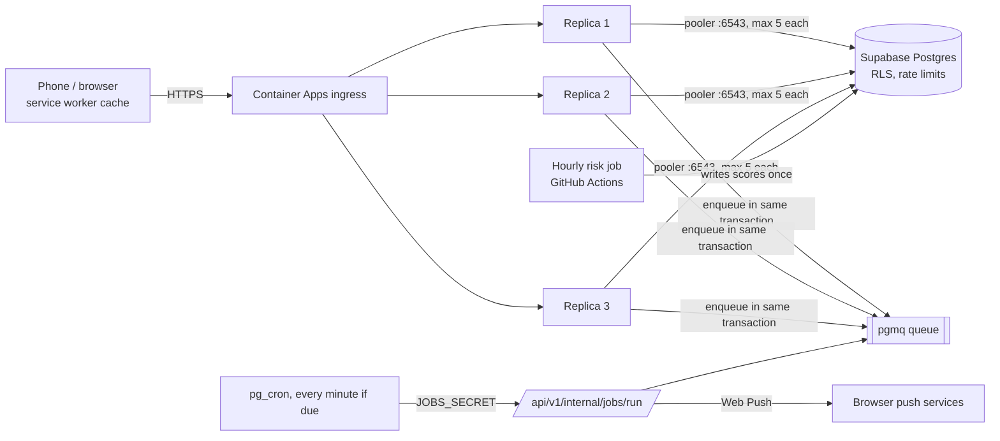

# Scaling

Only what is built and configured is described here. "Not built" says so.

## 1. Compute once, read many

Risk is scored once an hour for everyone by `jobs/run_risk.py` (GitHub Actions, `.github/workflows/risk-job.yml`), not per request. A request for risk reads one stored row per zone and horizon. This is the main reason the app stays cheap under load: 1 user and 10,000 users cost the scoring job the same.

## 2. The read path: HTTP cache, ETag and memory cache

`GET /api/v1/risk` and `/risk/summary` (`/zones` never changes and is sent with `max-age=3600`):

- `ETag` is the latest `run_at`. A client that sends it back in `If-None-Match` gets `304 Not Modified` with no body.
- `Cache-Control: public, max-age=60, s-maxage=300, stale-while-revalidate=3300`, because the data changes once an hour.
- Each server instance keeps the last answer in memory for 60 s, so most requests never reach the database.
- Not built: a shared Redis cache. Nobody created an Upstash account, and section 17 allows us to skip it. The memory cache plus HTTP caching covers our load.

### Measured

`node scripts/load/risk.mjs http://localhost:3100 10`: production build (`next start`) on an Apple M4 laptop, reading the real Supabase database in Mumbai, 10 connections, 10 s per run. Measured on 25 Nov 2026.

| Run | p50 ms | p90 ms | p97.5 ms | p99 ms | req/s | errors |
| --- | --- | --- | --- | --- | --- | --- |
| Cold first request (one sample, goes to the database) | 1069 | | | | | |
| Warm (200, from the memory cache) | 3 | 4 | 4 | 6 | 2980 | 0 |
| Revalidate (304 with the ETag) | 2 | 3 | 4 | 4 | 3449 | 0 |

autocannon reports p97.5 rather than p95. These numbers are for one process on a laptop, not the deployed app; the cold number is mostly the round trip to Mumbai and the first database connection.

## 3. The write path: a queue

- `POST /api/v1/reports` and official updates save the row and enqueue a job **in the same transaction** (Supabase Queues, `pgmq`), then return. Photos are cleaned synchronously before the save (EXIF stripped, resized), so no unclean photo is ever stored.
- The worker, `POST /api/v1/internal/jobs/run`, protected by `JOBS_SECRET` and running as the `routeguard_worker` database role, does the slow work: Web Push fan-out to the zones each subscriber follows.
- `pg_cron` wakes the worker every minute, but only when a job is due, so an idle app can scale to zero.
- A job that fails 5 times goes to a dead-letter table, shown at `/admin/jobs`.

## 4. Horizontal scaling on Azure Container Apps

- **Stateless app.** Sessions are Clerk tokens. Rate limits are counted in Postgres (`private.rate_limits`), so they hold across replicas. The memory cache is only an optimisation: losing it costs one database read.
- **Settings** (in `.github/workflows/deploy.yml`): 0.5 vCPU, 1 GiB, `min-replicas 0`, `max-replicas 3`, HTTP scale rule at 80 concurrent requests. The Container Apps ingress balances across replicas. With min 0 nothing is charged while nobody uses the app; before the demo we warm it up by calling `/api/v1/health/ready`.
- **Database connections:** Drizzle over the Supabase transaction pooler (port 6543), at most 5 connections per replica, so 3 replicas use at most 15.
- Not measured yet: the replica count rising under load on Azure. That needs the app deployed; the plan is a one- or two-minute run of `scripts/load/risk.mjs` against the live URL with a screenshot of the portal's Metrics page.

## 5. Not built

- Read replicas for Postgres. A next step if reads ever outgrow one database, which the cache makes unlikely.
- Redis (see section 2).

## Diagram

